# BestID: cartilla digital de tu mascota

App móvil para Android e iOS que digitaliza la cartilla de vacunación de perros y gatos, guarda su historial y avisa cuándo toca la próxima vacuna o desparasitación. Mercado inicial: Perú (UI en español es-PE). Todos los datos se guardan en el teléfono: no hay cuenta ni servidor.

La especificación completa está en [`docs/SYSTEM_DESIGN.md`](docs/SYSTEM_DESIGN.md) y las decisiones tomadas durante el desarrollo, en [`docs/DECISIONS.md`](docs/DECISIONS.md).

## Estado

| Hito | Contenido | Estado |
|---|---|---|
| M0 | Proyecto multimódulo, design system con previews, 4 pestañas, CI Android e iOS | Hecho |
| M1 | Mascotas (crear, editar, eliminar, varias, selector), vacunas a mano, Cartilla, Detalle, Inicio | Hecho |
| M2 | Motor de avisos, notificaciones, Salud (cuidados y peso con gráfico) | Hecho; falta la prueba en un iPhone real |
| M3 | Fotos: bienvenida, fotos de la cartilla, sticker, foto de la mascota, visor | Hecho en código (sin lectura automática, ver D29); falta probar en teléfonos reales |
| M3b | Lectura automática de la cartilla (Leyendo, Revisar lectura, cola sin internet) | Pendiente: falta elegir la tecnología de lectura |
| M4 | PDF para compartir, respaldo (exportar e importar), Ajustes | Hecho en código; falta probar Android ↔ iOS en teléfonos reales |
| M5 | Estados vacíos y de error, accesibilidad, textos finales, fichas de tienda, beta cerrada | Hecho en código; falta la beta con 10 dueños (ver [`docs/BETA.md`](docs/BETA.md)) |

## Pantallas

Capturas del prototipo de diseño ([`docs/design/`](docs/design/)), que la app sigue. Las capturas de la app real se generan en local al correr `./gradlew iosSimulatorArm64Test` en un Mac (quedan en `composeApp/build/ui-screenshots/`).

| Inicio | Cartilla | Detalle de vacuna | Nueva vacuna |
|---|---|---|---|
| 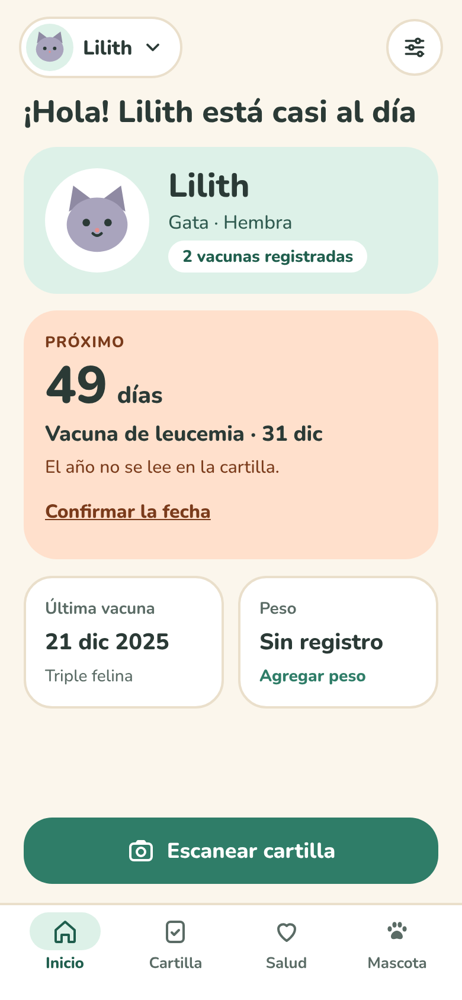 | 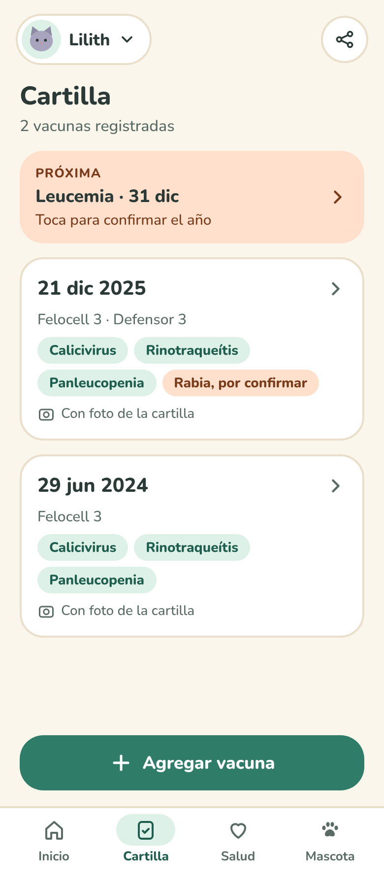 | 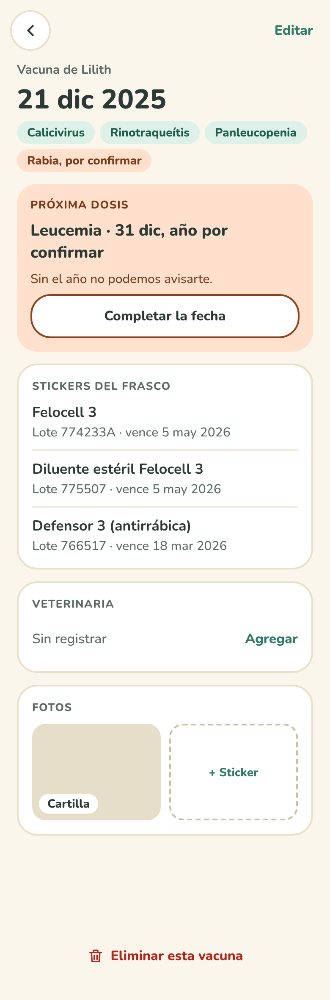 | 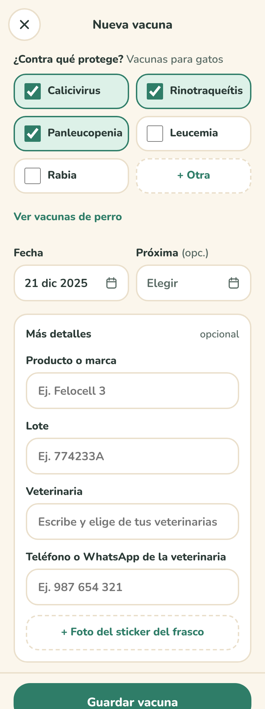 |

| Mascota (carnet) | Nueva mascota | Salud: cuidados | Salud: peso |
|---|---|---|---|
| 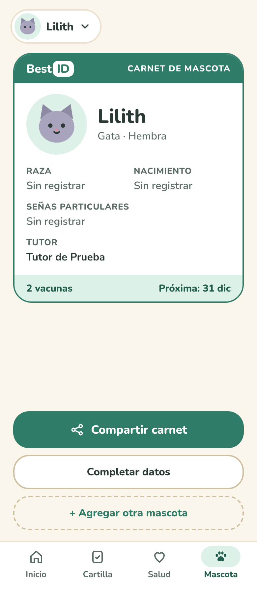 | 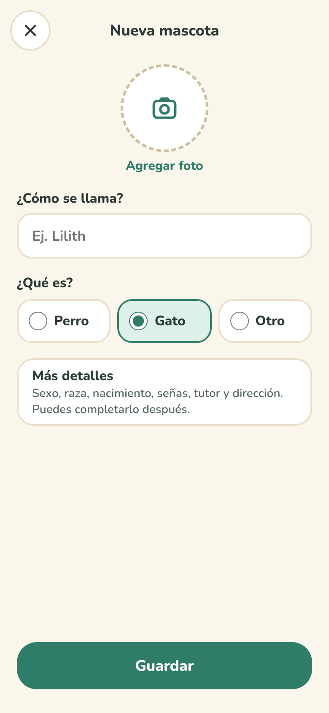 | 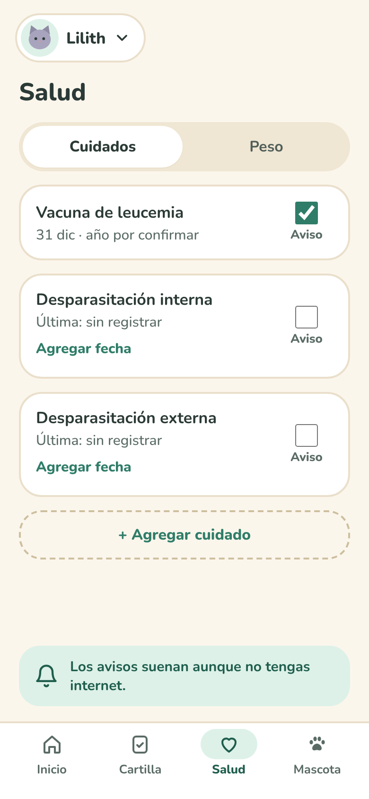 | 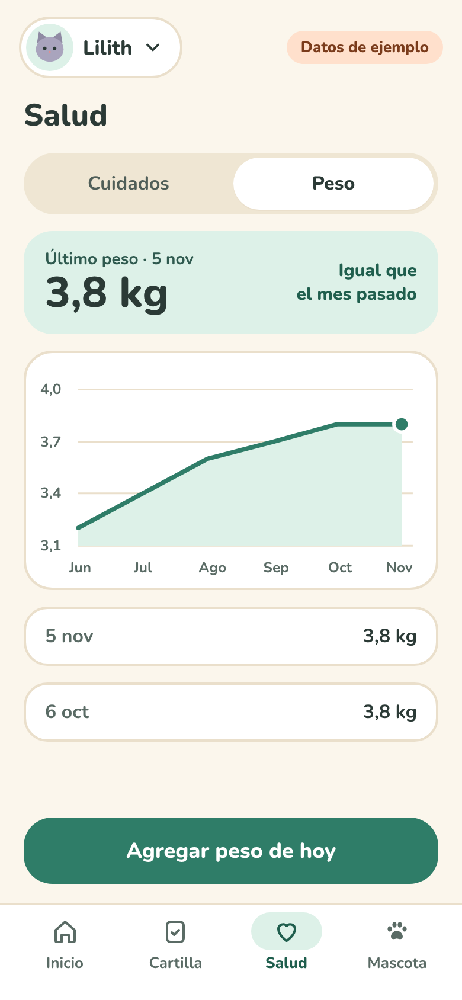 |

| Bienvenida | Fotos de la cartilla | Revisar lectura | Compartir ficha |
|---|---|---|---|
| 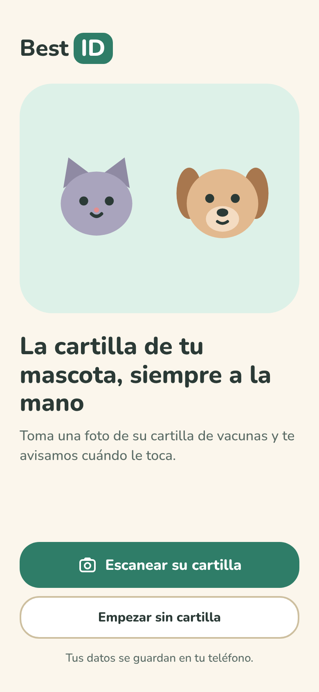 | 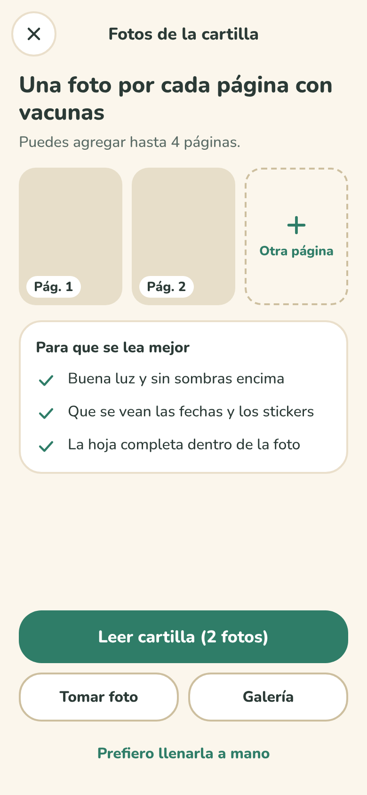 | 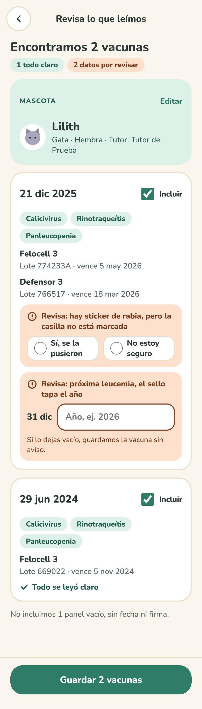 | 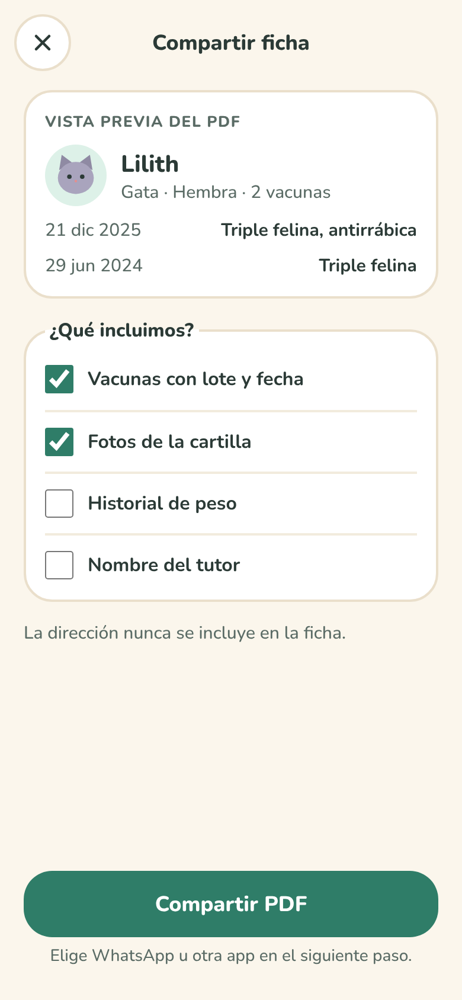 |

Componentes y tokens: [`docs/design/screens/15-componentes.png`](docs/design/screens/15-componentes.png).

## Stack

- Kotlin Multiplatform con Compose Multiplatform (Material 3, Compose Resources)
- Navigation Compose con rutas tipadas, ViewModel y StateFlow con flujo unidireccional
- Koin para inyección
- Room KMP con SQLite empaquetado y DataStore, todo local
- kotlinx-datetime, kotlinx.serialization y Coil 3

Las versiones están en [`gradle/libs.versions.toml`](gradle/libs.versions.toml).

## Estructura del proyecto

```
androidApp/          Punto de entrada Android (Application, MainActivity, manifiesto, ícono)
composeApp/          Raíz de la UI compartida: App(), navegación, Koin, MainViewController de iOS
core/
  model/             Entidades y enums (Kotlin puro)
  domain/            Casos de uso, validaciones, próxima dosis, motor de avisos, puertos
  data/              Room, DataStore, repositorios, fotos y respaldo en zip; esquemas en core/data/schemas/
  designsystem/      Tokens, AppTheme, componentes con previews, íconos, fuente Nunito, catálogo
  ui/                Presentación compartida entre features: especie, sexo, fechas es-PE, plurales
  navigation/        Rutas tipadas; los features navegan solo a través de ellas
  platform/          Adaptadores Android e iOS: fecha, avisos, cámara, galería, fotos, PDF, compartir y elegir archivo
feature/
  home/              Inicio
  cartilla/          Cartilla, fotos de la cartilla, detalle y formulario de vacuna
  health/            Salud (cuidados y peso)
  pet/               Carnet y formulario de mascota
  onboarding/        Primer uso: bienvenida y permiso de avisos
  share/             Compartir la ficha en PDF
  settings/          Ajustes y respaldo
build-logic/         Plugins de convención de Gradle (bestid.kmp.library, .compose, .feature)
iosApp/              Proyecto Xcode
docs/                SYSTEM_DESIGN.md, DECISIONS.md, BETA.md, store/ (fichas), legal/ (privacidad), licencias y design/
.github/             CI: compila Android y corre las pruebas de JVM; scripts para probar en emulador y simulador en local
```

Reglas de dependencia:
- Un feature nunca depende de otro feature.
- `core/designsystem` no depende de `core/model`.
- `core/domain` no depende de UI ni de código de plataforma.

## Cómo correrla

Requisitos: JDK 21, Android Studio (aporta el Android SDK, que Gradle necesita incluso para compilar iOS) y, para iOS, un Mac con Xcode.

- **Android:** abre el proyecto en Android Studio y corre `androidApp`, o por terminal `./gradlew :androidApp:assembleDebug`.
- **iOS:** abre `iosApp/iosApp.xcodeproj` en Xcode y corre en un simulador. La primera compilación descarga Kotlin/Native y tarda varios minutos. Para un iPhone real, copia `iosApp/Configuration/Secrets.xcconfig.example` como `Secrets.xcconfig` y completa `TEAM_ID`.
- **Reglas del proyecto:** `.github/scripts/check-rules.sh` (colores, tamaños, textos, privacidad, dependencias).
- **Pruebas:** `./gradlew allTests` (JVM y host de Android). En Mac, también `./gradlew iosSimulatorArm64Test`, que incluye los flujos de M1 a M4 y la prueba de accesibilidad con texto al 200 % en el simulador.
- **Fotos en Android:** el emulador no tiene cámara real (muestra una escena virtual); para la galería, arrastra imágenes a la ventana del emulador y se guardan en Descargas.
- **Procesado de fotos en Android** (con un emulador o teléfono conectado): `./gradlew :core:platform:connectedAndroidDeviceTest`.
- **Avisos en Android de punta a punta** (emulador encendido): `.github/scripts/android-reminders-e2e.sh build/android-e2e`.
- **Respaldo:** Ajustes → Respaldo → "Exportar respaldo" lo manda a la hoja de compartir. En el otro teléfono, "Importar respaldo" (o "Tengo un respaldo" en la Bienvenida).
- **Avisos (debug):** Ajustes → "Probar aviso en 1 minuto" programa un aviso de prueba; cierra la app (o reinicia el teléfono) y espera.
- **Catálogo de componentes y "Probar aviso" (solo en debug):** Ajustes (engranaje arriba a la derecha) → "Herramientas de prueba".
- **Beta (Google Play y TestFlight):** ver [`docs/BETA.md`](docs/BETA.md).

## Licencias de terceros

Fuente Nunito (SIL OFL) e íconos Material Symbols (Apache 2.0): ver [`docs/licenses/`](docs/licenses/).
